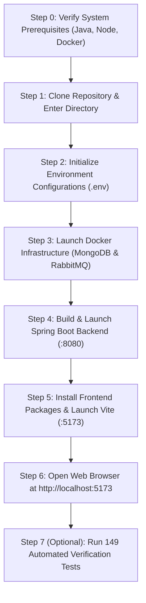

# CHAIN55 — Agent-Based Modelling of Distributed Ledger Participant Behaviour

[](https://openjdk.org/)
[](https://spring.io/projects/spring-boot)
[](https://react.dev/)
[](https://threejs.org/)
[](https://www.mongodb.com/)
[](https://www.rabbitmq.com/)
[](#verification--automated-testing)
[](#key-features)

**CHAIN55** is an interactive, full-stack **Agent-Based Blockchain Simulation, Research & Learning Platform** built as a Complex Adaptive Systems (CAS) laboratory. Rather than assuming all blockchain nodes behave identically, CHAIN55 models every validator and peer as an autonomous, stateful software agent interacting over realistic peer-to-peer (P2P) topologies—revealing how honest, inactive, slow, and malicious (Byzantine) behaviors drive macro-level consensus stability, forks, throughput, and wealth centralization.

---

## Table of Contents

- [📦 Expected Package Download (EPD) — Complete Setup & Installation Manual](#-expected-package-download-epd--complete-setup--installation-manual)
  - [1. EPD Overview & Safety Guarantee](#1-epd-overview--safety-guarantee)
  - [2. Estimated Download & Installation Time Breakdown](#2-estimated-download--installation-time-breakdown)
  - [3. Complete Package & File Inventory](#3-complete-package--file-inventory)
  - [4. Step-by-Step Installation & Execution Manual](#4-step-by-step-installation--execution-manual)
  - [5. Troubleshooting, Port Conflicts & Safety FAQs](#5-troubleshooting-port-conflicts--safety-faqs)
- [Problem Statement & Core Aim](#problem-statement--core-aim)
- [Key Features](#key-features)
- [System Architecture & Tech Stack](#system-architecture--tech-stack)
- [Theoretical & Research Foundation](#theoretical--research-foundation)
- [Research Experiments & Metrics](#research-experiments--metrics)
- [Repository Structure](#repository-structure)
- [Getting Started (Quick Reference)](#getting-started-quick-reference)
- [Verification & Automated Testing](#verification--automated-testing)
- [Project Team & Credits](#project-team--credits)

---

## 📦 Expected Package Download (EPD) — Complete Setup & Installation Manual

> [!IMPORTANT]
> **New User Notice & Safe Execution Policy:**  
> If you are a new developer, researcher, or evaluator cloning this repository for the first time, this **Expected Package Download (EPD)** manual details **every single file, runtime, dependency, container image, and package** required to run CHAIN55 from scratch.  
> - **100% Non-Destructive & Isolated:** All dependencies are sandbox-isolated inside local project subdirectories (`frontend/node_modules/`, `~/.m2/repository`, and isolated Docker containers `chain55-mongo` and `chain55-rabbitmq`). No system-level configurations are altered, and no root/administrator privileges are required beyond standard Docker service execution.
> - **Zero Guesswork:** Exact terminal commands for **Windows (PowerShell/CMD)** and **macOS / Linux** are provided below.

---

### 1. EPD Overview & Safety Guarantee

CHAIN55 is a multi-tier distributed application consisting of:
1. **Core System Runtimes:** Java Development Kit (JDK 17+), Node.js (18+ LTS), Git, and Docker Desktop.
2. **Infrastructure Containers:** MongoDB 7.0 (database store) and RabbitMQ 3.13-management (message broker).
3. **Backend Dependencies:** Java Spring Boot AMQP, WebSocket, Data MongoDB, Security, Jackson, and JUnit 5 (automatically resolved via Maven Wrapper `./mvnw` / `mvnw.cmd`).
4. **Frontend Packages:** React 19, Vite, Three.js 3D WebGL engine, React Three Fiber, Framer Motion, STOMP/SockJS, Axios, and Oxlint (automatically resolved via `npm install`).

All network operations are bound strictly to `localhost` (`127.0.0.1`). No open inbound internet ports are created.

---

### 2. Estimated Download & Installation Time Breakdown

Review this table to decide whether to download and launch the system immediately or explore the codebase documentation first:

| Phase | Component / Package Type | Download Size | Disk Footprint | Est. Time (Fast: 100+ Mbps) | Est. Time (Moderate: 25–50 Mbps) | Est. Time (Slow: <10 Mbps) |
| :--- | :--- | :--- | :--- | :--- | :--- | :--- |
| **Phase 0** | **System Runtimes** (JDK 17 + Node.js 18+ + Docker) | *If not installed* (~450 MB) | ~1.2 GB | 2 – 4 min | 5 – 8 min | 15 – 20 min |
| **Phase 1** | **Repository Source Tree** (`git clone`) | ~25 MB | ~45 MB | < 15 sec | ~30 sec | ~1 min |
| **Phase 2** | **Docker Containers** (`mongo:latest`, `rabbitmq:3-management`) | ~420 MB | ~950 MB | 1 – 2 min | 3 – 5 min | 8 – 12 min |
| **Phase 3** | **Backend Maven Dependencies** (via Maven Wrapper `mvnw`) | ~120 MB | ~280 MB | 45 – 90 sec | 2 – 3 min | 5 – 7 min |
| **Phase 4** | **Frontend npm Packages** (`node_modules`) | ~140 MB | ~360 MB | 30 – 60 sec | 1 – 2 min | 4 – 6 min |
| **Phase 5** | **Application Build & Launch** (Vite HMR + Spring Boot JVM) | 0 MB (Local) | ~50 MB (`dist/`) | ~30 sec | ~45 sec | ~1 min |
| **TOTAL** | **Complete Full-Stack Installation** | **~700 MB – 1.1 GB** | **~1.7 – 2.8 GB** | **~5 – 8 minutes** | **~12 – 18 minutes** | **~25 – 35 minutes** |

> [!TIP]
> **Can I download later?** Yes! If you are currently on a metered or slow connection, you can browse the architecture, simulation roadmap, and research datasets directly in the repository ([`docs/`](file:///d:/CP1/CHAIN55/PROJECT%20B/docs)) without downloading any packages.

---

### 3. Complete Package & File Inventory

Here is the exhaustive directory of every package, tool, and file downloaded or generated:

#### A. System Prerequisites (To be downloaded by user if missing)
- **Git** (v2.30+): Version control tool used to clone the repository.
- **Java Development Kit (JDK 17 or JDK 21 LTS)**: OpenJDK, Eclipse Temurin, or Oracle JDK 17+. Required to compile and run the Spring Boot CAS simulation engine.
- **Node.js (v18.0.0+ / v20+ / v23+ LTS)** & **npm (v9+ / v11+)**: JavaScript runtime engine and package manager for the frontend.
- **Docker Desktop & Docker Compose** (v2.0+): Container virtualization engine to run MongoDB and RabbitMQ with zero host pollution.
- *(Optional)* **Python 3.8+**: Only required if running the research report generation script (`docs/research-results/generate_report.py`). Uses standard library only (`json`, `datetime`, `pathlib`).

#### B. Configuration Files to Create
- **Root `.env`**: Copy from `.env.example`. Configures database URI, broker host, CORS origins, and session cookie parameters.
- **Backend `.env`**: Located at `Backend/Backend/.env.example` -> `Backend/Backend/.env`.
- **Frontend `.env`**: Located at `frontend/.env.example` -> `frontend/.env`. Points the Vite app to `http://localhost:8080/api` and `http://localhost:8080/ws-simulation`.

#### C. Docker Container Images (Downloaded via `docker-compose up -d`)
- `mongo:latest` (~700 MB uncompressed): MongoDB database engine for user authentication credentials, simulation configurations, sequence run histories, and research blog articles.
- `rabbitmq:3-management` (~260 MB uncompressed): AMQP message broker with embedded web management dashboard at port `15672` for asynchronous simulation job queueing.

#### D. Backend Dependencies (Downloaded automatically via `./mvnw` / `mvnw.cmd` into `~/.m2/repository`)
- `org.springframework.boot:spring-boot-starter-web`: Embedded Apache Tomcat web server and Spring MVC framework.
- `org.springframework.boot:spring-boot-starter-data-mongodb`: Spring Data ODM and reactive MongoDB drivers.
- `org.springframework.boot:spring-boot-starter-amqp`: RabbitMQ message broker integration and listener adapters.
- `org.springframework.boot:spring-boot-starter-websocket`: STOMP protocol message broker, WebSocket endpoints, and SockJS protocol fallbacks.
- `org.springframework.boot:spring-boot-starter-security`: Spring Security authentication filter chain and BCrypt password encryption.
- `com.fasterxml.jackson.core:jackson-databind`: JSON serialization/deserialization for REST APIs and WebSocket telemetry ticks.
- `org.springframework.boot:spring-boot-starter-webmvc-test` & `spring-boot-starter-websocket-test`: JUnit 5 Jupiter engine, Mockito, and AssertJ test infrastructure (powering the 149 passing automated tests).
- `org.apache.maven.plugins:maven-compiler-plugin` & `maven-surefire-plugin`: Compilation and automated phased test runner.

#### E. Frontend Packages (Downloaded automatically via `npm install` into `frontend/node_modules/`)
- **Core UI & Build Engine:**
  - `react` (`^19.2.8`) & `react-dom` (`^19.2.8`): Core React 19 component library.
  - `vite` (`^8.3.0`) & `@vitejs/plugin-react` (`^6.1.1`): Blazing-fast ES module build system and local dev server.
  - `react-router-dom` (`^7.18.4`): Client-side Single Page Application (SPA) routing for all 10 pages.
- **3D Cosmic Agent Visualizer Engine:**
  - `three` (`^0.186.1`): WebGL 3D graphics rendering engine for procedural galactic agent simulation.
  - `@react-three/fiber` (`^9.8.1`): React reconciler for Three.js.
  - `@react-three/drei` (`^10.7.9`): React Three.js helper components (OrbitControls, cameras, shaders).
  - `@react-three/postprocessing` (`^3.1.3`): Visual effects (bloom, noise, glow shaders).
- **Networking & Real-Time Telemetry:**
  - `@stomp/stompjs` (`^7.3.0`): STOMP protocol client over WebSockets for live agent telemetry.
  - `sockjs-client` (`^1.6.1`): WebSocket fallback transport client.
  - `axios` (`^1.20.0`): Promise-based HTTP client for REST backend communication.
- **Animation, UI & Tooling:**
  - `framer-motion` (`^13.4.4`): Physics-based motion animations for transitions and modal drawers.
  - `lucide-react` (`^1.48.0`): Vector UI iconography.
  - `@studio-freight/lenis` (`^1.0.42`): Smooth page scrolling engine.
  - `oxlint` (`^1.81.0`): High-performance Rust-based JavaScript/JSX code linter.
  - `@types/react` (`^19.2.18`) & `@types/react-dom` (`^19.2.7`): TypeScript definitions for development.

---

### 4. Step-by-Step Installation & Execution Manual

Follow these sequential steps in order. Each step verifies before proceeding.



#### Step 0: Verify System Prerequisites
Open your terminal and verify that the prerequisite tools are installed:

```bash
# Verify Git
git --version

# Verify Java (must be JDK 17 or higher)
java -version

# Verify Node.js and npm (Node must be v18+; npm v9+)
node -v
npm -v

# Verify Docker engine
docker --version
docker-compose --version
```

*(If any command is not found, install the respective tool from its official website: [Git](https://git-scm.com/), [JDK 17+](https://adoptium.net/), [Node.js](https://nodejs.org/), [Docker Desktop](https://www.docker.com/products/docker-desktop/)).*

---

#### Step 1: Clone the Repository
Clone the codebase and navigate into the workspace directory:

```bash
git clone https://github.com/KVRPavanShanmukh/CP1-2.git
cd CP1-2
```

---

#### Step 2: Initialize Environment Configurations
Generate the local `.env` configuration files from the provided `.env.example` templates:

**Windows (PowerShell):**
```powershell
Copy-Item .env.example .env
Copy-Item Backend\Backend\.env.example Backend\Backend\.env
Copy-Item frontend\.env.example frontend\.env
```

**macOS / Linux (Bash):**
```bash
cp .env.example .env
cp Backend/Backend/.env.example Backend/Backend/.env
cp frontend/.env.example frontend/.env
```

*Note: The default settings work out-of-the-box for local execution with zero manual modifications required.*

---

#### Step 3: Launch Docker Infrastructure (MongoDB & RabbitMQ)
Download the container images and start the database and message broker:

```bash
docker-compose up -d
```

**Verify Container Status:**
```bash
docker ps
```
*You should see `chain55-mongo` (port 27017) and `chain55-rabbitmq` (ports 5672, 15672) running in a healthy state.*

---

#### Step 4: Download Backend Dependencies & Start Spring Boot
The project includes the Maven Wrapper (`mvnw` / `mvnw.cmd`), which downloads the exact Maven distribution and all required Java packages without needing a standalone Maven installation.

**Windows (PowerShell / Command Prompt):**
```powershell
cd Backend\Backend
.\mvnw.cmd spring-boot:run
```

**macOS / Linux:**
```bash
cd Backend/Backend
chmod +x mvnw
./mvnw spring-boot:run
```

*Expected output: Spring Boot starts up on port `8080` (e.g., `Started BackendApplication in X.XXX seconds`).*  
*Leave this terminal window running.*

---

#### Step 5: Download Frontend Packages & Start Vite Dev Server
Open a **new terminal window** and navigate to the `frontend/` directory to download all npm packages:

```bash
cd frontend

# Download and install all React 19, Three.js, and Vite packages (~140 MB download)
npm install

# Start the Vite development server with Hot Module Replacement
npm run dev
```

*Expected output:*
```text
  VITE v8.3.1  ready in 280 ms

  ➜  Local:   http://localhost:5173/
  ➜  Network: use --host to expose
```

---

#### Step 6: Access the Application & Verify Operation
Open your web browser and navigate to:
- **Frontend Web UI:** [`http://localhost:5173`](http://localhost:5173)
- **Backend REST API:** [`http://localhost:8080/api/simulations/history`](http://localhost:8080/api/simulations/history)
- **RabbitMQ Management Console:** [`http://localhost:15672`](http://localhost:15672) (Username: `guest` / Password: `guest`)

**Quick Walkthrough:**
1. Navigate to [`http://localhost:5173`](http://localhost:5173). The app redirects to `/login`.
2. Sign in or register a new researcher account (or click **Quick Demo Login**).
3. Click **LAUNCH SIMULATOR** in the navigation bar to access the full parameter studio (`/simulation`).
4. Select consensus (e.g., `PoW` or `PoS`), set node count, and click **START SIMULATION**.
5. The live Three.js 3D Cosmic Visualizer automatically opens at `/agent`, streaming real-time galactic agent states and P2P gossip pulses over WebSockets!

---

#### Step 7 (Optional): Run the Full Automated Verification Test Suite
To verify the integrity of all 13 research phases and the frontend code:

**Run the 149 Backend JUnit 5 Automated Tests:**
```powershell
# In Backend\Backend directory
.\mvnw.cmd test          # Windows
./mvnw test              # macOS / Linux
```
*Result: `Tests run: 149, Failures: 0, Errors: 0, Skipped: 0` -> `BUILD SUCCESS`.*

**Run Frontend Lint & Production Build:**
```bash
# In frontend directory
npm run lint             # Fast Oxlint code analysis
npm run build            # Vite production bundle build
```

---

### 5. Troubleshooting, Port Conflicts & Safety FAQs

#### Q1: What ports does CHAIN55 use, and what if a port is in use?
| Port | Service | Used By | What to do if occupied |
| :--- | :--- | :--- | :--- |
| `5173` | Vite Dev Server | Frontend UI | Vite auto-picks the next port (e.g. `5174`), or set `PORT=3000` |
| `8080` | Spring Boot API | Backend Service | Set `PORT=8081` in root `.env` and `VITE_API_BASE_URL` in `frontend/.env` |
| `27017` | MongoDB | Database | Modify host port in `docker-compose.yml` (e.g. `"27018:27017"`) |
| `5672` | RabbitMQ AMQP | Queue Broker | Modify `RABBITMQ_PORT` in `.env` |
| `15672` | RabbitMQ Dashboard | Web UI | Modify host port in `docker-compose.yml` |

#### Q2: How do I cleanly stop or shut down the platform?
- In the frontend and backend terminal windows, press `Ctrl + C`.
- In the root project directory, stop the Docker containers:
  ```bash
  docker-compose down
  ```
- To stop the containers while preserving the database records:
  ```bash
  docker-compose stop
  ```

#### Q3: How do I completely uninstall and remove all downloaded files?
Since all downloads are locally contained:
1. Stop and remove Docker containers and volumes: `docker-compose down -v`
2. Delete the cloned project folder: `rm -rf CP1-2` (or delete in File Explorer).
3. (Optional) Clear the local Maven cache: delete `~/.m2/repository/com/ProB` or clear `~/.m2/repository`.

#### Q4: "PowerShell says `mvnw.cmd` cannot be loaded because running scripts is disabled."
Run PowerShell with process execution bypass (requires no admin privileges):
```powershell
Set-ExecutionPolicy -Scope Process -ExecutionPolicy Bypass
```

#### Q5: "Docker daemon error: Cannot connect to the Docker daemon."
Start Docker Desktop on your machine and wait until the whale icon in the taskbar indicates "Docker Desktop is running".

---

## Problem Statement & Core Aim

Traditional analytical models for Distributed Ledger Technology (DLT) assume **homogeneous participant behavior** to simplify mathematical modeling. Real blockchain networks violate that assumption: nodes can be honest, malicious (executing equivocation or block withholding), inactive, or hindered by high latency, packet loss, and network partitions.

CHAIN55 provides a low-cost, repeatable testbed to answer critical pre-deployment questions:
- How does consensus degrade when a fraction of validators turn Byzantine or go offline?
- Under what latency, packet loss, or network partition conditions does a unified chain disintegrate into disconnected forks?
- How do consensus mechanisms and P2P network topologies shape transaction throughput, fork intensity, and wealth/decision-making centralization?

---

## Key Features

### 1. Complex Adaptive Systems (CAS) Simulation Engine (Phases 1–13)
- **Autonomous Stateful Agents:** Each `BlockchainAgent` maintains local state (node ID, stake/balance, P2P neighbors, local blocktree `BlockchainState`, local `TransactionMempool`, and latest peer attestations).
- **Adversarial & Fault Modeling:** Dedicated `ByzantineNodeAgent` supporting configurable malicious ratios and attack modes (e.g., attestation equivocation, block withholding), alongside configurable inactive node ratios.
- **5 Pluggable Consensus Mechanisms (`ConsensusStrategy`):**
  - Proof of Work (**PoW**) — Hash-difficulty target mining.
  - Proof of Stake (**PoS**) — Proportional stake-weighted proposer selection.
  - Delegated Proof of Stake (**DPoS**) — Top-voted delegate witness scheduling.
  - Proof of Authority (**PoA**) — Authorized validator signer round-robin rotation.
  - Proof of Location (**PoL**) — Coordinate latency-proximity scoring.
- **Fork Choice Rule:** Local **LMD GHOST** (*Latest Message Driven Greediest Heaviest Observed SubTree*) head selection (`LmdGhostForkChoice`) with monotonic block IDs (`b1`, `b2`, ...) for bit-reproducible multi-seed experiments.
- **3 P2P Network Topologies & Reliability Faults (`NetworkModel`):**
  - **Erdős–Rényi** (Random), **Small-World** (Watts–Strogatz), and **Scale-Free** (Barabási–Albert) graphs.
  - Configurable slot duration, propagation latency jitter, probabilistic packet loss, and timed network partitions.

### 2. Live 3D Cosmic Agent Visualizer (`/agent`)
- Launching a simulation from `/simulation` automatically opens the live Three.js WebGL cosmic stage streamed via **WebSocket / STOMP**.
- **Space-Themed Visual Encoding:**
  - **Honest Active Agents:** Swirling cyan spiral galaxies with glowing solid particle cores.
  - **Active Slot Proposers:** Radiant golden super-galaxies / quasars with pulsating orbital shock rings.
  - **Inactive / Offline Agents:** Dim silver-slate dormant galaxies.
  - **Byzantine / Malicious Agents:** Jagged, molten crimson-glowing meteoroids.
  - **P2P Topology Links:** Thick, glowing cyan cylinder bridges carrying live animated block, attestation, transaction, and attack pulses between exact neighbor pairs.
- **Interactive Inspection:** Full 3D `OrbitControls` (zoom, pan, rotate), live telemetry event feed, dynamic HUD, and click-to-inspect **Node Inspector** displaying any agent's role, stake, head block, mempool size, neighbors, and active actions.

### 3. Analytics, Learning & Architecture Hub
- **Simulation Lab ([`/simulation`](http://localhost:5173/simulation)):** Full-parameter configuration studio (15+ parameters) with live SVG tick trend charts, Run History drawer, and Archived Experiments viewer.
- **Analytics Dashboard ([`/dashboard`](http://localhost:5173/dashboard)):** Persisted simulation history and macro-performance metrics ($\mu$, $F$, $G$, agreement) loaded live from MongoDB.
- **Technical Architecture Explorer ([`/architecture`](http://localhost:5173/architecture)):** Dedicated full-stack architectural breakdown of all 5 tiers of CHAIN55.
- **Interactive Learn Hub ([`/learning`](http://localhost:5173/learning)):** Five structured educational modules covering CAS/ABM principles, consensus mechanisms, network topologies & phase transitions, adversarial faults, and metric interpretation.
- **Simulation Manual ([`/manual`](http://localhost:5173/manual)):** Comprehensive guide detailing Configuration, Execution, and Analysis steps.
- **Research Abstract ([`/abstract`](http://localhost:5173/abstract)):** Theoretical abstract summarizing research findings and empirical phase-transition laws.
- **Researcher Blog & User Profile ([`/blog`](http://localhost:5173/blog), [`/profile`](http://localhost:5173/profile)):** Discussion forum and researcher profile management.
- **Multi-Seed Statistical Experiment Suite (`com.sim.experiment`):** Automated baseline-vs-treatment runner with statistical aggregation and factor-change detection across 27 metrics.

---

## System Architecture & Tech Stack

```text
┌───────────────────────────────────────────┐      REST API (Axios)      ┌──────────────────────────────────┐
│              Frontend Layer               │ ─────────────────────────► │          Backend Layer           │
│        React 19 + Vite + Three.js         │                            │    Java 17 + Spring Boot         │
│ Simulation (/simulation) Agent (/agent)   │ ◄─── WebSocket / STOMP ─── │ SimulationController / Security  │
│ Dashboard / Architecture / Learning / etc │       (Live Telemetry)     │ SimulationOrchestratorService    │
└───────────────────────────────────────────┘                            └───────────┬──────────────┬───────┘
                                                                                     │              │
                                                                    Persist Configs  │              │ Publish Job
                                                                    & Results        ▼              ▼
                                                                         ┌────────────────┐  ┌──────────────┐
                                                                         │    MongoDB     │  │   RabbitMQ   │
                                                                         │  (Spring Data) │  │ (Async Queue)│
                                                                         └────────────────┘  └──────┬───────┘
                                                                                                    │ Consume Job
                                                                                                    ▼
                                                                         ┌──────────────────────────────────┐
                                                                         │    Simulation Processing Layer   │
                                                                         │ SimulationWorker + Engine (P1-13)│
                                                                         │ Agents / LMD-GHOST / NetworkModel│
                                                                         └──────────────────────────────────┘
```

| Layer | Technologies Used | Key Responsibilities |
| :--- | :--- | :--- |
| **Frontend & 3D WebGL** | React 19, Vite, Three.js, React Three Fiber, Drei, Postprocessing, Framer Motion, Lenis, Oxlint | High-performance reactive UI, 60 FPS WebGL 3D cosmic agent simulation, client-side routing across 10 pages |
| **Backend & CAS Engine** | Java 17, Spring Boot, Maven, Spring Security, Jackson | Autonomous multi-agent lifecycle, 5 consensus strategies, LMD-GHOST fork choice, network topology graph models |
| **Database & Persistence** | MongoDB 7.0, Spring Data MongoDB | Document persistence for simulation configs, tick history, results, BCrypt user credentials, blog posts |
| **Async Broker & Streaming** | RabbitMQ 3.13, Spring WebSocket, STOMP, SockJS | Background simulation job queuing, decoupled worker execution, sub-second live tick & telemetry streaming |
| **Infrastructure & Quality** | Docker Compose, JUnit 5 (149 tests), Python 3 | Containerized multi-service orchestration, automated 13-phase empirical verification, scientific report generation |

---

## Theoretical & Research Foundation

CHAIN55 synthesizes mechanics and mathematical metrics from four peer-reviewed studies:

1. **Kraner, Vallarano, Tessone, & Schwarz-Schilling (2023)** — *Agent-Based Modelling of Ethereum Consensus* (`arXiv:2305.13906`): LMD GHOST fork choice, slot/attestation thresholds, block and attestation gossip latencies, reorg/balancing threats, and latency-driven phase transitions.
2. **Wei, Li, & He (2020)** — *Impacts of Consensus Protocols and Trade Network Topologies on Blockchain System Performance* (*JASSS* 23(3)): Comparative evaluation of PoW, PoS, and DPoS across Random, Small-World, and Scale-Free topologies using Gini inequality and trade efficiency.
3. **Mueller-Bloch, Andersen, Spasovski, & Hahn (2022)** — *Understanding Decentralization of Decision-Making Power in Proof-of-Stake Blockchains* (*EJIS*): Formal Complex Adaptive Systems (CAS) mapping (generative rules, elemental micro-agents, observed macro-outcomes) and Lorenz-curve Gini centralization analysis.
4. **Lin, Dziubałtowska, Macek, Penzkofer, & Müller (2023)** — *TangleSim: An Agent-Based, Modular Simulator for DAG-Based DLTs* (`arXiv:2305.01232`): Modular gossip/solidification pipelines, heterogeneous link delays, packet loss, and Byzantine adversarial models.

---

## Research Experiments & Metrics

### Core Mathematical Metrics
- **Mainchain Rate ($\mu$):** Proportion of produced blocks retained in the canonical chain ($\mu \to 1$ indicates healthy consensus):
  $$\mu = \frac{\vert{}M\vert{}}{\vert{}B\vert{}} = 1 - \frac{\vert{}\Theta\vert{}}{\vert{}B\vert{}}$$
- **Branching Ratio ($F$):** Fork intensity off the mainchain ($F = 0$ indicates zero forks):
  $$F = \frac{\vert{}\Theta\vert{}}{\vert{}M\vert{}} = \frac{1 - \mu}{\mu}$$
- **Consensus Phase-Transition Law:** Consensus disintegrates into competing forks when network diameter times block latency exceeds slot duration:
  $$D(\mathcal{G})\tau_{\text{block}} > T_{\text{slot}}$$
- **Gini Coefficient ($G \in [0, 1]$):** Measures wealth and decision-making centralization across participants ($0$ = uniform decentralization, $1$ = monopoly centralization).

### Included Experiment Datasets (`docs/research-results/`)
- `exp1-network-latency.json` — Impact of propagation latency on mainchain rate and branching ratio
- `exp2-packet-loss.json` — Network degradation under probabilistic packet drops
- `exp3-network-partition.json` — Consensus divergence and recovery across timed network splits
- `exp4-byzantine.json` — Resilience under varying fractions of adversarial Byzantine nodes
- `exp5-tx-load.json` — Mempool dynamics, throughput, and confirmation performance under load
- `exp6-consensus-{PoS, DPoS, PoA, PoL}.json` — Cross-protocol consensus comparisons
- `RESEARCH_RESULTS_REPORT.md` — Compiled statistical analysis across all experiments

---

## Repository Structure

```text
CHAIN55/
├── docker-compose.yml                  # MongoDB & RabbitMQ containers
├── .env.example                        # Root environment variable template
├── Backend/
│   └── Backend/
│       ├── pom.xml                     # Maven dependencies (Java 17 / Spring Boot)
│       ├── mvnw / mvnw.cmd             # Maven Wrapper scripts (auto-resolves Maven 3.9+)
│       ├── .env.example                # Backend-specific environment template
│       ├── src/main/java/com/
│       │   ├── ProB/Backend/           # Spring Boot application entry point
│       │   └── sim/
│       │       ├── agent/              # BlockchainAgent, ByzantineNodeAgent, TransactionMempool
│       │       ├── blockchain/         # Block, Attestation, BlockchainState
│       │       ├── consensus/          # ConsensusStrategy (PoW/PoS/DPoS/PoA/PoL), LmdGhostForkChoice
│       │       ├── network/            # NetworkModel, NetworkMessage
│       │       ├── engine/             # SimulationEngine, SimulationState, SimulationTick
│       │       ├── metrics/            # MetricsCalculator, GiniCalculator, MetricsSnapshot
│       │       ├── experiment/         # Multi-seed statistical comparison framework
│       │       ├── worker/             # SimulationWorker (async execution + live telemetry)
│       │       ├── controller/         # REST API controllers
│       │       ├── service/            # Orchestration, WebSocket streaming, research results, auth
│       │       ├── listener/           # RabbitMQListener
│       │       ├── config/             # Security, MongoDB seeding, RabbitMQ, WebSocket, Jackson
│       │       ├── model/              # SimulationConfig, TickUpdate, Node/Edge/EventTelemetry
│       │       └── repository/         # Spring Data MongoDB repositories
│       └── src/test/java/com/sim/      # 149 JUnit 5 Tests (Phase1AgentTests .. Phase13 + Worker tests)
├── frontend/
│   ├── package.json                    # React 19, Vite, Three.js, Axios, React Router, Oxlint
│   ├── .env.example                    # Frontend environment template
│   └── src/
│       ├── components/                 # Navbar, InteractiveShape, SimulationCursor, NexusTeam
│       ├── pages/                      # 10 Full-Featured Pages:
│       │   ├── Landing.jsx             # Cyberpunk presentation & live preview
│       │   ├── Login.jsx               # Authentication & demo sign-in
│       │   ├── Simulation.jsx          # 15+ parameter simulation lab with SVG charts & drawers
│       │   ├── Agent.jsx               # Live 3D Cosmic WebGL Agent Visualizer (Three.js)
│       │   ├── Dashboard.jsx           # MongoDB persistent history & consensus metrics
│       │   ├── Architecture.jsx        # 5-tier system technical specification
│       │   ├── Learning.jsx            # 5 educational theory modules
│       │   ├── Manual.jsx              # Simulation execution manual
│       │   ├── Abstract.jsx            # Academic research abstract
│       │   ├── Profile.jsx             # User profile & session management
│       │   └── Blog.jsx                # Consensus research blog articles
│       └── services/api.js             # Shared REST & WebSocket STOMP client
└── docs/
    ├── SIMULATION_ROADMAP.md           # 13-phase engineering roadmap
    ├── RESEARCH_EXPERIMENT_PLAN.md     # Experimental design specification
    ├── FINAL_COMPLETION_SUMMARY.md     # Release audit & verification summary
    └── research-results/               # exp1–exp6 JSON datasets, report & generator script
```

---

## Getting Started (Quick Reference)

For the detailed package download manual and step-by-step instructions, see the [📦 Expected Package Download (EPD)](#-expected-package-download-epd--complete-setup--installation-manual) section above.

### Quick Start in 4 Commands:

```bash
# 1. Start MongoDB and RabbitMQ
docker-compose up -d

# 2. Run Backend (in Backend/Backend)
cd Backend/Backend
./mvnw spring-boot:run     # or .\mvnw.cmd spring-boot:run on Windows

# 3. Run Frontend (in frontend, in another terminal)
cd frontend
npm install
npm run dev

# 4. Open http://localhost:5173 in your browser
```

---

## Verification & Automated Testing

### Backend Test Suite (149 Automated Tests)
Run the full phased test suite (`Phase1AgentTests` through `Phase13ResearchExperiments`, `SimulationWorkerTests`, and `BackendApplicationTests`):

```powershell
# Windows
cd Backend\Backend
.\mvnw.cmd test

# macOS / Linux
cd Backend/Backend
./mvnw test
```
*Expected Result:*  
`[INFO] Tests run: 149, Failures: 0, Errors: 0, Skipped: 0`  
`[INFO] BUILD SUCCESS`

### Frontend Production Build & Code Quality
```bash
cd frontend

# High-speed Oxlint linting
npm run lint

# Production Vite bundle build
npm run build
```
*Expected Result:* Zero lint errors and complete production bundle compilation in `dist/`.

---

## Project Team & Credits

Developed at the **Department of Computer Science & Information Technology, KL University (Vijayawada, Andhra Pradesh, India — Capstone Batch 73)**.

| Name | Role | Contributions |
| :--- | :--- | :--- |
| **Jupalli Pravallika** | **Team Leader** | Project leadership & coordination, literature survey, research documentation, and consensus algorithm comparison |
| **K.V.R. Sai Pavan Shanmukh** | **Core Backend & Lead Full-Stack System Architect** | End-to-end architecture and development: Java Spring Boot CAS simulation engine (Phases 1–13), all 5 consensus protocols, P2P network topologies, RabbitMQ + WebSocket live telemetry, statistical research engine, React 19 + Vite frontend, Three.js 3D Cosmic Agent Visualizer, and full-stack integration |
| **Janga Sathvik Reddy** | **Database Management** | MongoDB schema configuration, document collections, and persistent storage management |
| **V Sai Ganesh** | **Testing & Quality Assurance** | Test case validation, quality assurance workflows, and consensus scenario verification |
| **Jaladi Rohan Kumar** | **Testing & Quality Assurance** | Simulation testing execution, scenario verification, and metric output validation |

**Faculty Guide & Research Mentor:** **K. Nirmala**, Department of Computer Science & Information Technology, KL University.
